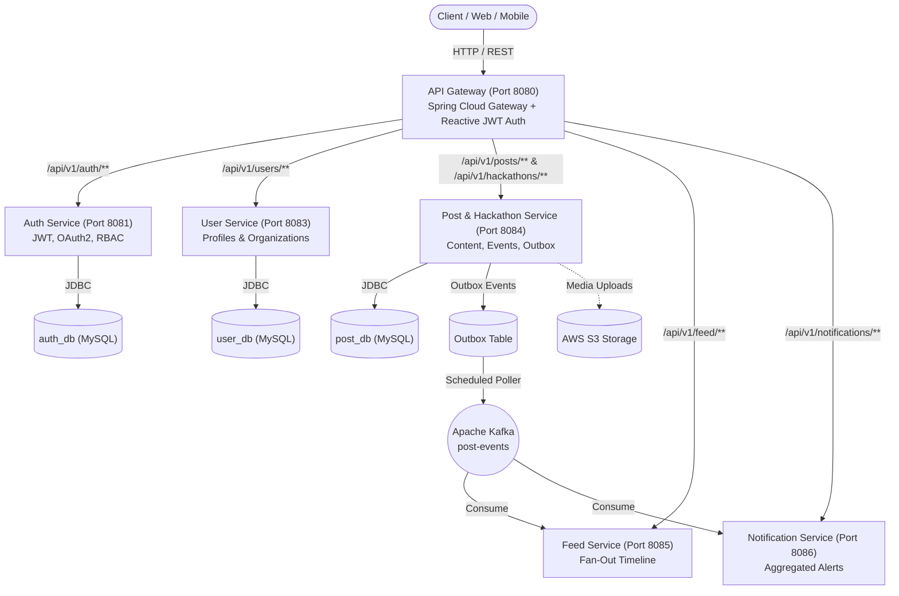

# Pulse — Distributed Microservices Platform

[](https://openjdk.org/projects/jdk/25/)
[](https://spring.io/projects/spring-boot)
[](https://spring.io/projects/spring-cloud-gateway)
[](https://www.mysql.com/)
[](https://kafka.apache.org/)
[](LICENSE)

**Pulse** is a distributed, event-driven microservices platform engineered for students, developers, and tech organizers. It powers authentication with GitHub OAuth2, rich developer profiles, hackathon lifecycle and team registrations, multimedia social content, transactional outbox messaging, and fan-out timeline feeds.

---

## 🏛 Architecture Overview



---

## 🚀 Microservices Breakdown

| Service | Port | Database | Primary Responsibilities |
|---|---|---|---|
| **`api-gateway`** | `8080` | — | Central entry point, Reactive WebFlux Security, JWT signature validation (HMAC-SHA384), path-based reverse proxy routing. |
| **`auth-service`** | `8081` | `auth_db` | Email/password registration & login, GitHub OAuth2 social authentication, JWT token issuance, Refresh Token rotation, RBAC (`USER`, `ORGANIZER`, `ADMIN`), and organizer role elevation. |
| **`user-service`** | `8083` | `user_db` | Developer/student profiles (degree, year, college, bio, avatar) and organizer profiles (organization name, type, website). |
| **`post-service`** | `8084` | `post_db` | Social posts, comments, likes, AWS S3 media uploads, Hackathon hosting & lifecycle, team/solo registrations with capacity capping, and Transactional Outbox publishing. |
| **`feed-service`** | `8085` | `feed_db` | Fan-out on write architecture. Consumes Kafka post events to construct and serve personalized feeds. |
| **`notificaiton-service`** | `8086` | `notification_db` | Event-driven notifications and batching scheduler for likes, comments, and event alerts. |

---

## ✨ Key Features

### 1. Authentication & Security
- **Stateless JWT with HMAC-SHA384**: Embeds user UUID, email, name, and role directly into signed claims.
- **Refresh Token Lifecycle**: Persistent, revokable refresh tokens with sliding expiration.
- **GitHub OAuth2 Integration**: Seamless one-click login for developers.
- **Role-Based Access Control**: Strict separation between `USER`, `ORGANIZER`, and `ADMIN`.

### 2. Hackathons & Organizer Ecosystem
- **Organizer Profiles**: Clubs, universities, and tech organizations can host and manage hackathons.
- **Event Lifecycle**: Configurable modes (`ONLINE`, `IN_PERSON`, `HYBRID`), team bounds (`minTeamSize`, `maxTeamSize`), and registration deadlines.
- **Team Registration & Capacity Enforcement**:
  - Case-insensitive team name grouping.
  - Automatic rejection when a team exceeds `maxTeamSize`.
  - Duplicate registration protection per user per hackathon.
  - Team roster lookup (`GET /api/v1/hackathons/{id}/teams/{teamName}`).
- **Participant Status Management**: Organizers can mark participants as `SHORTLISTED`, `PARTICIPATED`, `WINNER`, or `RUNNER_UP`.

### 3. Posts & Hackathon Project Showcases
- **Flexible Posts**: Supports regular text, media attachments via AWS S3, or optional hackathon tags.
- **Tag Badges**: Users can tag hackathons with badges (`WINNER`, `RUNNER_UP`, `PARTICIPATED`, `PROJECT_SHOWCASE`, `MENTOR`).
- **Showcase Feed**: View all project showcases and winning posts directly on any hackathon page (`GET /api/v1/hackathons/{id}/posts`).

### 4. Distributed Resilience
- **Transactional Outbox Pattern**: Database writes and event creation commit in the exact same transaction, eliminating dual-write failures.
- **Scheduled Event Dispatcher**: Emits outbox events to Apache Kafka with exponential backoff and retry limits.

---

## 📡 API Reference

All requests pass through the **API Gateway** on port `8080`.

### Authentication (`/api/v1/auth`)
- `POST /api/v1/auth/register` — Register a new account (`name`, `email`, `password`, optional `role`).
- `POST /api/v1/auth/login` — Authenticate and receive `accessToken` + `refreshToken`.
- `POST /api/v1/auth/refresh` — Rotate refresh token and get a new access token.
- `POST /api/v1/auth/logout` — Revoke active refresh token.
- `GET /api/v1/auth/github` — Initiate GitHub OAuth2 flow.
- `POST /api/v1/auth/upgrade-to-organizer` — Upgrade current authenticated user to `ORGANIZER`.

### User Profiles (`/api/v1/users`)
- `POST /api/v1/users/create-profile` — Create student or organizer profile.
- `GET /api/v1/users/profile` — Fetch current user's profile.
- `GET /api/v1/users/me` — Alias for profile fetch.

### Hackathons (`/api/v1/hackathons`)
- `POST /api/v1/hackathons` — Create a new hackathon *(Organizer/Admin only)*.
- `GET /api/v1/hackathons` — List published hackathons (optional `?status=REGISTRATION_OPEN`).
- `GET /api/v1/hackathons/{id}` — Get hackathon details and registration metrics.
- `PUT /api/v1/hackathons/{id}` — Update hackathon *(Organizer only)*.
- `DELETE /api/v1/hackathons/{id}` — Delete hackathon *(Organizer only)*.
- `GET /api/v1/hackathons/my` — Get hackathons hosted by the authenticated organizer.
- `POST /api/v1/hackathons/{id}/register` — Register for a hackathon (solo or with `teamName`).
- `GET /api/v1/hackathons/{id}/registrations` — View all registrations *(Organizer only)*.
- `GET /api/v1/hackathons/my-registrations` — View hackathons the current user is registered for.
- `GET /api/v1/hackathons/{id}/teams/{teamName}` — View all registered members of a specific team.
- `PUT /api/v1/hackathons/{id}/registrations/{regId}/status` — Update participant status (`WINNER`, etc.) *(Organizer only)*.
- `GET /api/v1/hackathons/{id}/posts` — Retrieve all posts tagged with this hackathon.

### Posts (`/api/v1/posts`)
- `POST /api/v1/posts` — Create a post (supports media files, optional `hackathonId` and `hackathonTagType`).
- `GET /api/v1/posts/{id}` — Get post details.
- `GET /api/v1/posts/my` — Get authenticated user's posts.
- `PUT /api/v1/posts/{id}` — Edit an existing post.
- `DELETE /api/v1/posts/{id}` — Delete post and trigger asynchronous media cleanup.
- `GET /api/v1/posts/hackathon/{hackathonId}` — Get all posts tagged with a hackathon.

---

## 🛠 Technology Stack

- **Language / Runtime:** Java 25
- **Frameworks:** Spring Boot 3.4.1, Spring Framework 6.2.15
- **Gateway & Security:** Spring Cloud Gateway, Spring Security 6, Nimbus JWT
- **Data & Persistence:** Spring Data JPA, Hibernate ORM, MySQL 8.0
- **Message Broker:** Apache Kafka 3.x
- **Cloud Storage:** AWS SDK for Java 2.x (Amazon S3)
- **Utilities:** Project Lombok (1.18.48), Jackson (JSR310 Date Module)

---

## ⚙ Local Development Setup

### 1. Prerequisites
- **JDK 25** installed and configured (`JAVA_HOME` pointing to JDK 25).
- **Apache Maven 3.9+**
- **MySQL 8.0+** running on `localhost:3306`
- **Apache Kafka** running on `localhost:9092` (optional for local auth & hackathon tests)

### 2. Database Initialization
Ensure MySQL is running, then create the required databases:
```sql
CREATE DATABASE IF NOT EXISTS auth_db;
CREATE DATABASE IF NOT EXISTS user_db;
CREATE DATABASE IF NOT EXISTS post_db;
CREATE DATABASE IF NOT EXISTS feed_db;
CREATE DATABASE IF NOT EXISTS notification_db;
```

### 3. Configuration
Each service contains an `application.properties` file in `src/main/resources/`. Configure your database credentials:
```properties
spring.datasource.url=jdbc:mysql://localhost:3306/auth_db?createDatabaseIfNotExist=true
spring.datasource.username=root
spring.datasource.password=YOUR_PASSWORD
```

### 4. Build All Services
From the root project directory:
```bash
mvn clean compile
```

### 5. Running the Services
Launch services in separate terminal windows or run background daemon processes:

```bash
# 1. API Gateway (Port 8080)
cd api-gateway && mvn spring-boot:run

# 2. Auth Service (Port 8081)
cd auth-service && mvn spring-boot:run

# 3. User Service (Port 8083)
cd user-service && mvn spring-boot:run

# 4. Post Service (Port 8084)
cd post-service && mvn spring-boot:run

# 5. Feed Service (Port 8085)
cd feed-service && mvn spring-boot:run

# 6. Notification Service (Port 8086)
cd notificaiton-service && mvn spring-boot:run
```

---

## 🧪 Testing

The repository includes automated test suites covering the entire end-to-end user journey:

```bash
# Run the 16-step Hackathon & RBAC test suite
python test_hackathons.py
```

**Test Coverage:**
- ✅ Organizer registration & JWT verification
- ✅ Non-organizer 403 Forbidden check
- ✅ Hackathon creation & status lifecycle
- ✅ Solo & team registration with unique constraints
- ✅ Team capacity capping (`maxTeamSize`)
- ✅ Team roster queries
- ✅ Status award updates (`WINNER`)
- ✅ Hackathon post tagging and showcase feed verification

---

## 📄 License
This project is licensed under the MIT License - see the [LICENSE](LICENSE) file for details.
