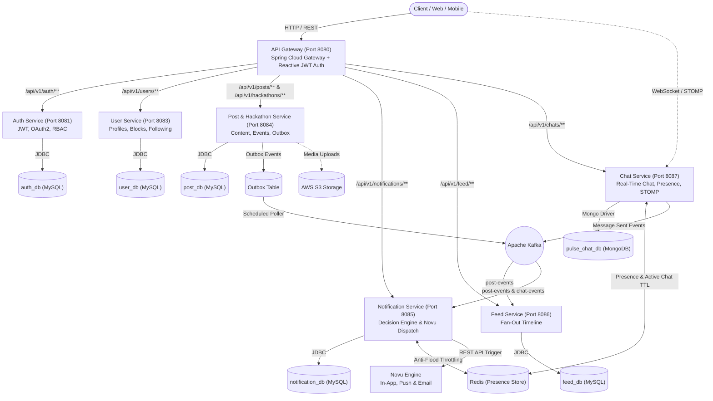

# Pulse — Distributed Microservices Platform

**Pulse** is a distributed, event-driven microservices platform engineered for students, developers, and tech organizers. It powers authentication with GitHub OAuth2, rich developer profiles, hackathon lifecycle and team registrations, multimedia social content, real-time WebSocket chat with active room presence detection, transactional outbox messaging, fan-out timeline feeds, and multi-channel notifications via Novu.

---

## 🏛 Architecture Overview

---

## 🚀 Microservices Breakdown

| Service | Port | Database / Storage | Primary Responsibilities |
|---|---|---|---|
| **`api-gateway`** | `8080` | — | Central entry point, Reactive WebFlux Security, JWT signature validation (HMAC-SHA384), path-based reverse proxy routing. |
| **`auth-service`** | `8081` | `auth_db` (MySQL) | Email/password registration & login, GitHub OAuth2 social authentication, JWT token issuance, Refresh Token rotation, RBAC (`USER`, `ORGANIZER`, `ADMIN`), and organizer role elevation. |
| **`user-service`** | `8083` | `user_db` (MySQL) | Developer/student profiles, organizer profiles, bidirectional user blocking, follow graph, and message privacy settings (`EVERYONE`, `FOLLOWERS_ONLY`). |
| **`post-service`** | `8084` | `post_db` (MySQL) | Social posts, comments, likes, AWS S3 media uploads, Hackathon hosting & lifecycle, team/solo registrations with capacity capping, and Transactional Outbox publishing. |
| **`notification-service`** | `8085` | `notification_db` (MySQL) | Event-driven notification engine for post likes and chat alerts, DND quiet hour evaluation, Redis anti-flood throttling, and multi-channel dispatch via Novu. |
| **`feed-service`** | `8086` | `feed_db` (MySQL) | Fan-out on write timeline architecture. Consumes Kafka post events to construct and serve personalized feeds. |
| **`chat-service`** | `8087` | `pulse_chat_db` (MongoDB) + Redis | 1-on-1, group, and hackathon team chat with STOMP WebSockets, conversation muting, and real-time active room presence tracking via Redis. |

---

## ✨ Key Features

### 1. Authentication & Security
- **Stateless JWT with HMAC-SHA384**: Embeds user UUID, email, name, and role directly into signed claims.
- **Refresh Token Lifecycle**: Persistent, revokable refresh tokens with sliding expiration.
- **GitHub OAuth2 Integration**: Seamless one-click login for developers.
- **Role-Based Access Control**: Strict separation between `USER`, `ORGANIZER`, and `ADMIN`.

### 2. Hackathons & Organizer Ecosystem
- **Organizer Profiles**: Clubs, universities, and tech organizations can host and manage hackathons.
- **Event Lifecycle**: Configurable modes (`ONLINE`, `IN_PERSON`, `HYBRID`), team bounds (`minTeamSize`, `maxTeamSize`), and registration deadlines.
- **Team Registration & Capacity Enforcement**:
  - Case-insensitive team name grouping with automatic rejection when a team exceeds `maxTeamSize`.
  - Duplicate registration protection per user per hackathon.
  - Team roster lookups and auto-provisioned hackathon team chats.
- **Participant Status Management**: Organizers can mark participants as `SHORTLISTED`, `PARTICIPATED`, `WINNER`, or `RUNNER_UP`.

### 3. Real-Time Chat & Presence System
- **STOMP WebSockets**: Sub-millisecond bi-directional messaging with delivered and read receipts.
- **Active Room Presence Detection**: Redis-backed active chat tracking (`presence:user:{id}:active_chat`) automatically suppresses notifications when the recipient is actively in the conversation screen.
- **Conversation Muting**: Granular muting per conversation (e.g., 8 hours, 1 week, or indefinitely).
- **User Blocking & Privacy Enforcement**: Prevents conversation creation or adding members if either party has blocked the other.

### 4. Multi-Channel Notification Engine (Novu)
- **Context-Aware Delivery**:
  - User in chat screen $\rightarrow$ Suppressed.
  - User elsewhere in app $\rightarrow$ In-App Toast notification.
  - User offline / locked $\rightarrow$ Mobile Push (FCM / APNs) via Novu.
- **Do Not Disturb (DND)**: User-configurable quiet hours (e.g., 10:00 PM – 7:00 AM) that suppress notifications while preserving unread history.
- **Anti-Flood Throttling**: Atomic Redis rate-limiting (5-second window) prevents push notification spam during rapid message exchanges.
- **Device Push Token Management**: Native endpoints for mobile clients to register FCM/APNs push credentials.

### 5. Distributed Resilience
- **Transactional Outbox Pattern**: Database writes and event creation commit in the exact same transaction, eliminating dual-write inconsistencies.
- **Kafka Event Streaming**: Fully decoupled asynchronous message dispatch between chat, posts, feed generation, and notification delivery.

---

## 🛠 Technology Stack

- **Language / Runtime:** Java 25
- **Frameworks:** Spring Boot 3.4.1, Spring Framework 6.2.15, Spring WebSocket (STOMP)
- **Gateway & Security:** Spring Cloud Gateway (Reactive), Spring Security 6, Nimbus JWT
- **Databases & Persistence:** 
  - Spring Data JPA, Hibernate ORM, MySQL 8.0
  - Spring Data MongoDB (Chat & Messages)
  - Spring Data Redis (Presence, Active Rooms, Anti-Flood Throttling)
- **Message Broker:** Apache Kafka 3.x
- **Notification Infrastructure:** Novu (In-App Center, Web Push, Mobile FCM/APNs)
- **Cloud Storage:** AWS SDK for Java 2.x (Amazon S3)
- **Utilities:** Project Lombok (1.18.48), Jackson (JSR310 Date Module)

---

## 📄 License
This project is licensed under the MIT License - see the [LICENSE](LICENSE) file for details.